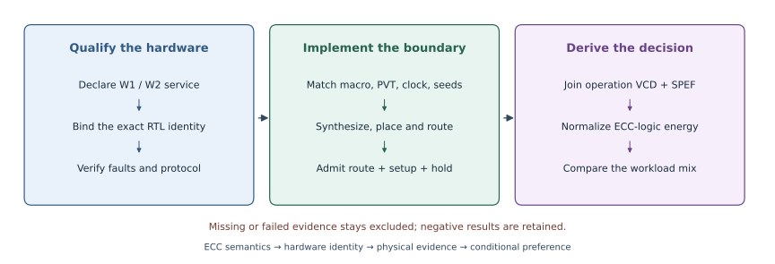

# GREENS

**Evidence-qualified open-source silicon research for memory ECC hardware**

[](https://github.com/wellitsabhinav/Error-Code-Correction/actions/workflows/fast-ci.yml)
[](https://github.com/wellitsabhinav/Error-Code-Correction/actions/workflows/ci.yml)
[](https://github.com/wellitsabhinav/Error-Code-Correction/actions/workflows/artifact-reproduction.yml)
[](requirements-lock.txt)
[](LICENSE)
[](https://orcid.org/0009-0001-4892-5438)

> **Research Project @ IIIT-Delhi — VICAS Lab**
>
> Developed by **[Abhinav Choudhary](https://orcid.org/0009-0001-4892-5438)**
> under the guidance of **Dr. Anuj Grover**.

GREENS asks how an SRAM designer can compare protection hardware using evidence from the exact implementation. ECC names describe correction and detection semantics; they do not fix latency, register placement, routing, timing, or operation energy. GREENS connects RTL and correctness evidence to open-source physical implementation, activity-aware measurements, and conditional reliability–energy decisions. The research attribution describes the project's origin and does not imply institutional endorsement.

## ⭐ ISCAS reproducibility artifact — start here

**“Evidence-Qualified Reliability–Energy Decision Boundaries for SRAM Protection”**
— Abhinav Choudhary and Anuj Grover. Manuscript; publication status is not independently verified.

| Reviewer task | Direct path |
|---|---|
| Understand the experiment and its admission gates | [Artifact overview](experiments/iscas/README.md) |
| Reproduce the claim derivations | [Exact instructions](experiments/iscas/reproduction.md) · [analysis entry point](scripts/reproduce_iscas.py) |
| Trace a headline number to its inputs | [Claim-to-evidence index](experiments/iscas/claims.md) |
| Inspect frozen activity evidence | [Frozen scientific evidence](experiments/iscas/evidence/README.md) · [campaign conditions](experiments/iscas/generated/campaign_conditions.json) |
| Inspect service, RTL, and physical identity | [Architecture audit](campaigns/iscas_sustainability_extension/green_v3_2_matched_openram_orfs_validation/ARCHITECTURE_AUDIT.md) · [memory-wrapper RTL](campaigns/iscas_sustainability_extension/green_v3_2_matched_openram_orfs_validation/validation/rtl/matched_memory_tops.sv) · [ORFS configurations](campaigns/iscas_sustainability_extension/green_v3_2_matched_openram_orfs_validation/orfs/) |
| Inspect reproduced tables and figure | [Generated derivations](experiments/iscas/generated/) · [results](docs/results.md) |
| Understand the evidence boundary | [Limitations](docs/limitations.md) · [optional physical regeneration](experiments/iscas/regeneration.md) |

> **What did we find?** Four matched Extended-Hamming/Hsiao pairs survive route, setup, hold, and complete-operation admission: **20 paired operation cells / 40 primary ECC-logic energy records**. Hsiao is lower in **4/20 cells**, and preference depends on operation mix. The evaluated BCH(78,64,t=2) RTL is setup-feasible in **0/5 seeds at 10 ns**; this describes that implementation and constraint. It does not establish a whole-SRAM lifecycle winner. [Calculation and source map →](experiments/iscas/claims.md)

The retained v3.3 total is 46 records / 23 cells. Six read records from seed 11 remain diagnostic: its Hsiao run fails hold and idle/write evidence is incomplete. The primary cohort uses seeds 13, 17, 19, and 23. The historical setup-only flag is preserved; the reviewer derivation checks setup **and hold** directly.


Negative deltas favor Hsiao within the measured ECC-logic boundary. The workload slice uses only clean reads and writes; it does not infer fault rates or whole-SRAM energy.

## Why an SRAM designer needs this

Choosing between “Hsiao is efficient” and “BCH corrects more errors” skips the engineering decision. Check the declared protection service, verify the exact RTL, qualify route and timing at the intended constraint, then compare routed energy for the intended operations. A different pipeline or decoder is a new hardware identity and requires new evidence.

**ECC semantics ≠ hardware architecture identity ≠ physical implementation identity.**



The flow preserves failed and incomplete evidence before comparing operation energy. [Architecture and evidence rules](docs/architecture.md) define the admitted identities.

## Hardware and qualification

| Hardware identity | Declared service | Role and boundary |
|---|---|---|
| Extended-Hamming SECDED (72,64) | W1 correct / W2 detect | Primary equal-service reference |
| Hsiao SECDED (72,64) | W1 correct / W2 detect | Primary equal-service comparison |
| BCH(78,64,t=2) | W1/W2 correct | Functionally admitted; evaluated RTL fails the common setup target |
| U0 (64 payload bits) | Unprotected | Inherited physical reference; no v3.3 E5 operation energy |
| Combinational/pipelined SECDED; flat/hierarchical Hsiao | Identity-specific equivalent transactions | Separate [identity-preserving technical study](docs/results.md#identity-preserving-hardware-study) |
| SEC-DAEC, interleaving proposals, other generated codecs | Record-specific | Functional failure, missing RTL, experimental, or software-only; [audit](campaigns/iscas_sustainability_extension/green_v3_2_matched_openram_orfs_validation/ARCHITECTURE_AUDIT.md) and [catalogue](docs/ECC_CATALOGUE.md) define status |

A directory's existence does not make its implementation paper-qualified. [Architecture guide](docs/architecture.md)

## Quick start: reproduce claims from frozen evidence

Use Python 3.10–3.12 and a repository clone. This path needs no EDA tools, PDK installation, or native build.

```bash
git -c core.longpaths=true clone --depth 1 https://github.com/wellitsabhinav/Error-Code-Correction.git GREENS
cd GREENS
git config core.longpaths true
python -m venv .venv
# Activate .venv in your shell, then:
python -m pip install -r requirements.txt
python scripts/reproduce_iscas.py
python scripts/reproduce_iscas.py --check
```

The first reproduction writes tables, a conditions manifest, and an SVG to `tmp/reproduce-iscas/`. `--check` compares regenerated numerical outputs with the [tracked references](experiments/iscas/generated/). `make reproduce-iscas` runs the same analysis. See [expected outputs and interpretation](experiments/iscas/reproduction.md).

**Regenerate physical implementations:** [use the separate instructions](experiments/iscas/regeneration.md) with the pinned Linux/container environment and a new campaign identity. A full RTL-to-GDS run is substantially more expensive and cannot restart the sealed campaign's expired budget.

## Results and research outputs

The primary energy comparison is conditional on SKY130HD, SRAM22 macro organization, TT/25 °C/1.8 V, 10 ns, routed-netlist activity, and the specified operation window. Clean reads can favor Hsiao; clean writes, correction, and detection can change that ordering. [Detailed results](docs/results.md) show the operation deltas and workload slice.

In the separate identity-preserving study at 10 ns, pipelined versus combinational SECDED changes mean standard-cell instance area by **+37.2%**, the **signed-slack-derived frequency estimate by +46.6%**, and energy/op by **−23.4%**, with request latency **1 → 3 cycles** and the directions repeated across **5/5 matched seeds**. Flat/hierarchical Hsiao has much smaller, mixed changes. Neither result establishes a universal implementation winner. [Evidence and scope](docs/results.md#identity-preserving-hardware-study)

| Research output | Focus | Evidence |
|---|---|---|
| Evidence-Qualified Reliability–Energy Decision Boundaries for SRAM Protection | Fail-closed SRAM protection decision regions | [ISCAS artifact](experiments/iscas/README.md) |
| Identity-preserving hardware study | Equivalent service versus physical outcomes | [Technical results](docs/results.md#identity-preserving-hardware-study) |

Publication metadata and review status are not invented. Submission PDFs are maintained outside this repository; see [research-output and anonymity policy](docs/papers.md).

## Repository map

| Path | Purpose |
|---|---|
| [experiments/iscas/](experiments/iscas/README.md) | Reviewer landing page, claim index, reproduction, generated derivations |
| [docs/](docs/README.md) | Project, architecture, methods, results, boundaries, contributor guides |
| [asic/](asic/docs/README_asic.md), [rtl/](rtl/) | Codec and wrapper RTL; campaign audits identify admitted sources |
| [tests/](tests/), [ASIC benches](asic/tb/), [formal gates](docs/date2027/) | Software/native tests and retained HDL/formal evidence |
| [flow configurations](campaigns/iscas_sustainability_extension/green_v3_2_matched_openram_orfs_validation/orfs/), [scripts/](scripts/) | Physical-flow inputs, analysis, reproduction |
| [campaigns/](campaigns/) | Frozen/additive evidence, manifests, failed and partial runs |
| [green_ecc_phy/](green_ecc_phy/), [architecture/](architecture/), [codeforge/](codeforge/), [ml/](ml/) | Registry, models, design exploration, advisory ML |
| [configs/](configs/), [schemas/](schemas/), [data/](data/) | Inputs and contracts |
| [reports/](reports/), [registry study](green_ecc_physical_simulation/), [archives](archives/README.md), [cleanup](cleanup/) | Retained study outputs and archival provenance |

Source, frozen evidence, generated derivations, and transient builds have distinct rules. [Layout and dependency audit](docs/maintenance/repository-overhaul.md)

<details>
<summary>Broader registry software study (separate from the ISCAS cohort)</summary>

<!-- BEGIN GENERATED:CURRENT_STATUS -->
**Current regenerated evidence:** 15 mathematical code specifications, 17 encoder/decoder implementations, 17 deployment architectures in the registry, and 15 selectable implementations.

The exact-functional and analytical study has 192 scenarios; 192 have a feasible winner and 0 have none. The evidence gate records 15 passing and 2 rejected implementations. Physical objectives remain null, so no physical winner, physical PPA comparison, or measured adaptive break-even is computable.

Source: [`framework_summary.json`](green_ecc_physical_simulation/multi_ecc_evaluation/framework_summary.json) and [`software_study_summary.json`](green_ecc_physical_simulation/multi_ecc_evaluation/software_study_summary.json).
<!-- END GENERATED:CURRENT_STATUS -->

</details>

## Evidence limits

These are post-route tool results. Silicon measurement, fabrication, tapeout, measured Fmax, absolute physical fault rates, verified bitcell adjacency, qualified Qcrit/radiation environment, system FIT/SDC/DUE rates, complete macro-internal energy, and a SKY130 embodied-carbon inventory are outside the established boundary. No calibrated whole-SRAM lifecycle winner or universal technology portability is claimed. [Limitations](docs/limitations.md)

## Contributing, citation, and license

Start with [CONTRIBUTING.md](CONTRIBUTING.md) and the authoritative [AGENTS.md](AGENTS.md). Software/native validation uses `make`, `make test`, `python -m pytest -q`, and `python scripts/check_artifact.py`. [Maintained dependency pins](docs/maintenance/dependencies.md) preserve the supported Python and CMake range. Fast CI checks public quality, software/native smoke and supported SECDED RTL; the full platform and artifact workflows provide the broader contracts. The manual experimental RTL diagnostic retains its documented legacy BCH counterexample.

If you use GREENS, cite [CITATION.cff](CITATION.cff) and the named evidence dataset. Primary researcher: [Abhinav Choudhary, ORCID 0009-0001-4892-5438](https://orcid.org/0009-0001-4892-5438). No paper DOI or acceptance is asserted.

GREENS retains the [MIT License](LICENSE). Third-party PDK/macro material retains upstream licensing and provenance. GREENS is the canonical public name; the historical GitHub URL and `GREEN` / `GREEN-ECC-PHY` source identifiers remain where required for compatibility and frozen traceability. [Naming migration](docs/maintenance/repository-overhaul.md#project-naming-and-github-migration)
