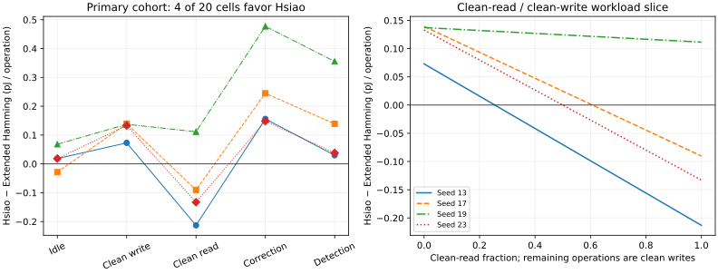

# GREENS results and their evidence boundaries

## ISCAS primary decision cohort

The [reviewer derivation](../scripts/reproduce_iscas.py) admits four Extended-Hamming/Hsiao pairs at 10 ns, seeds **13,17,19,23**, with route/setup/hold and all five operation classes qualified. That gives **20 paired cells / 40 primary energy records**; Hsiao is lower in **4/20 cells**. [Exact pair table](../experiments/iscas/generated/primary_operation_pairs.csv) · [Claim index](../experiments/iscas/claims.md)

| Operation | Matched cells | Hsiao lower | Mean Hsiao − Extended-Hamming (pJ/op) |
|---|---:|---:|---:|
| Idle | 4 | 1 | +0.019108 |
| Clean write | 4 | 0 | +0.120682 |
| Clean read | 4 | 3 | −0.081182 |
| Single-error correction | 4 | 0 | +0.256536 |
| Double-error detection | 4 | 0 | +0.140507 |

These rounded values come from [operation_summary.csv](../experiments/iscas/generated/operation_summary.csv). The seeds are deterministic physical replicates, and operation cells sharing a routed implementation are not independent process-population samples.

The right panel evaluates a two-operation slice: clean-read weight varies from 0 to 1, clean-write weight is its complement, and idle/correction/detection weights are zero. The full expression is ΔE(w) = Σ wₒ(E_Hsiao,ₒ − E_SECDED,ₒ). A negative value favors Hsiao within this measured ECC-logic boundary. The slice is an illustrative workload decision region, not an inferred memory workload or physical fault distribution.

## Retained diagnostics and feasibility

The historical v3.3 campaign retains **46 records / 23 matched cells**. Seed 11 has six qualified read records but an Hsiao hold violation (−0.0137477 ns, one violation) and unavailable idle/write activity. It is excluded from the primary set and remains visible in [cohort_admission.csv](../experiments/iscas/generated/cohort_admission.csv). Historical setup-only flags and aggregates are preserved verbatim.

The evaluated BCH(78,64,t=2) RTL provides stronger W1/W2 correction semantics but is setup-feasible in **0/5 seeds at 10 ns**. [Per-seed reports](../experiments/iscas/generated/bch_setup_feasibility.csv) bind that result to the exact inherited implementation. A pipelined or iterative BCH decoder is another hardware identity and needs another experiment.

U0 and broader code-registry entries are not assigned missing E5 energies. Fresh OpenRAM did not complete a qualified 256×72 macro; inherited SRAM22 material provides a separate boundary. [Negative results](experiments/negative_results.md)

## Identity-preserving hardware study

This is a separate technical comparison, not another population to fill missing ISCAS operands. The [controlled statistics](../campaigns/date_2027_activity_qualified_ecc_energy_rev2/data/controlled_implementation_statistics.json) and [qualification explanation](../campaigns/date_2027_activity_qualified_ecc_energy_rev2/CONTROLLED_IMPLEMENTATION_EVIDENCE.md) provide the retained derivations.

| Exact control at 10 ns | Area delta | Signed-slack-derived frequency-estimate delta | Energy/op delta | Service timing |
|---|---:|---:|---:|---|
| Pipelined minus combinational SECDED | +37.201864% | +46.629355% | −23.419005% | Request latency 1 → 3 cycles; II = 1; directions across 5/5 matched seeds |
| Hierarchical minus flat Hsiao | −0.564122% | +2.655651% | +1.328395% | Same matrix, latency, and II; small, mixed effects |

The frequency quantity is a signed-slack-derived estimate, not measured Fmax or maximum sustainable architectural throughput. Semantic equivalence does not imply physical equality; structural differences do not guarantee large PPA changes. These controls do not establish that pipelining or either Hsiao structure universally wins.

Only technical evidence is presented while review status remains unconfirmed. Publication-specific metadata and submission PDFs are omitted. [Research-output policy](papers.md)

## Unresolved lifecycle boundary

ECC-logic operation energy is not full SRAM energy. Macro internal power, physical fault rates, verified bitcell mapping, qualified Qcrit/radiation environment, system FIT/SDC/DUE, and a SKY130 manufacturing inventory remain incomplete or unavailable. Lifecycle expressions must retain those terms symbolically. No calibrated whole-SRAM lifecycle winner or universal technology portability is established. [Limitations](limitations.md)
