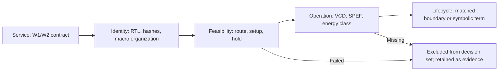

# GREENS — ISCAS reproducibility artifact

**Evidence-Qualified Reliability–Energy Decision Boundaries for SRAM Protection**

Abhinav Choudhary and Anuj Grover. Manuscript identification supplied by the project owner; publication status unverified. [Research context and citation](../../docs/papers.md)

**Start:** [Reproduce the claims](reproduction.md) · [Claim-to-evidence map](claims.md) · [Generated tables and figure](generated/) · [Limitations](../../docs/limitations.md)

## Scope and architecture population

The artifact evaluates the exact protection service and hardware identity before admitting energy comparisons. Extended-Hamming and Hsiao (72,64) supply W1 correction/W2 detection. The evaluated BCH(78,64,t=2) supplies W1/W2 correction but fails the common setup constraint. U0 is an inherited unprotected physical reference, without v3.3 E5 activity-energy records. SEC-DAEC is functionally excluded; pipelined SECDED lacks this campaign's memory wrapper; interleaving lacks admitted RTL/topology evidence. [Architecture audit](../../campaigns/iscas_sustainability_extension/green_v3_2_matched_openram_orfs_validation/ARCHITECTURE_AUDIT.md)



**Fail closed:** failed or missing evidence remains visible and is never repaired using measurements from another implementation or boundary.

## Frozen experiment conditions

| Control | Evidence boundary |
|---|---|
| Physical technology | SKY130HD, TT, 25 °C, 1.8 V |
| Macro organization | Inherited SRAM22 256×64 plus 256×8 views; 72-bit protected memory interface |
| Primary clock | 10 ns; 5 ns is an inherited sensitivity population |
| Deterministic seeds | Tested: 11, 13, 17, 19, 23; primary pairs: 13, 17, 19, 23 |
| Operations | IDLE, WRITE_CLEAN, READ_CLEAN, READ_SINGLE_BIT_ERROR_CORRECT, READ_DOUBLE_BIT_ERROR_DETECT |
| Activity | Zero-delay routed-netlist VCD; final SPEF; 16 warm-up cycles and 256 measured operations |
| Tools | Pinned ORFS container; [conditions manifest](generated/campaign_conditions.json) records the scientific controls |
| Flow exception | Common SRAM22 transition-stage resize bypass; residual DRVs/signoff limits remain visible |
| Energy boundary | E5 ECC logic only; macro-internal energy incomplete |

The declared workload/window, macro views, and exceptions are recorded in the [conditions manifest](generated/campaign_conditions.json). Nominal 256-cycle scheduling does not replace each record's measured window in energy normalization.

## What survived qualification?

Route completion, nonnegative setup and hold slack, zero reported hold violations, and all five qualified operations admit **four matched implementation pairs**, **20 paired operation cells**, and **40 primary energy records**. Hsiao is lower in **4/20 cells**. Seed 11's Hsiao hold slack is **−0.0137477 ns** with one hold violation, and its canonical idle/write activity is blocked. Its six available read records remain diagnostic. [Admission table](generated/cohort_admission.csv)

The frozen campaign retains **46 energy records / 23 operation cells** and uses a historical setup-only `timing_feasible` flag. This new reviewer layer does not overwrite that flag or those aggregates. It applies route/setup/hold and complete-operation gates for the primary decision set. The evaluated BCH identity is setup-feasible in **0/5 seeds at 10 ns**. [Claim map](claims.md)

The result is an operation-dependent preference region. Clean reads can favor Hsiao; write, correction, and detection activity can change the ordering. There is no qualified universal SECDED energy winner and no calibrated whole-SRAM lifecycle winner.

## Reproduce paper-level claims

From a prepared repository root:

```bash
python scripts/reproduce_iscas.py
python scripts/reproduce_iscas.py --check
```

The runner verifies all **1,697 v3.3 seal entries**, reuses the existing read-only raw-evidence collector, checks parent/report identities, reconstructs operation energy from power/window/count, joins matched workloads, and validates the supplied headline claim set. It emits CSV/JSON tables and an SVG into `tmp/reproduce-iscas/`; `--check` compares numerical outputs against tracked references. [Setup, expected outputs, and troubleshooting](reproduction.md)

## Evidence and directory map

| Path | Role |
|---|---|
| [v3.2 matched campaign](../../campaigns/iscas_sustainability_extension/green_v3_2_matched_openram_orfs_validation/) | Service audit, correctness, source/flow identities, 40-run physical foundation including failed targets |
| [v3.3 activity campaign](../../campaigns/iscas_sustainability_extension/green_v3_3_activity_complete_e5/) | Raw operation records, netlists, SPEF, compressed VCD, power reports, completed budget and seal |
| [RUN_MANIFEST.json](../../campaigns/iscas_sustainability_extension/green_v3_3_activity_complete_e5/RUN_MANIFEST.json) | Canonical executed sources and 46 historical records |
| [claims.md](claims.md) | Headline → derivation → source → output |
| [scripts index](scripts/README.md) | Maintained entry point and frozen analysis implementation |
| [generated/](generated/) | Intentional reviewer derivations; source data remain in campaigns |
| [regeneration.md](regeneration.md) | Separate optional RTL-to-GDS procedure and requirements |

## Integrity and limits

Machine-readable integrity records validate the inputs automatically; reviewers do not need to interpret development identifiers. Frozen campaign paths/bytes remain unchanged. Reproduction verifies the supplied headline numbers; the private manuscript's exact table numbering and layout are not available for comparison. The new workload figure is a transparent repository derivation, not a claimed original manuscript figure.

Incomplete macro power, physical upset rates, bitcell mapping, Qcrit, radiation environment, system FIT/SDC/DUE, SKY130 manufacturing inventory, and technology portability limit lifecycle conclusions. [Evidence model](../../docs/evidence-model.md) · [Limitations](../../docs/limitations.md)
